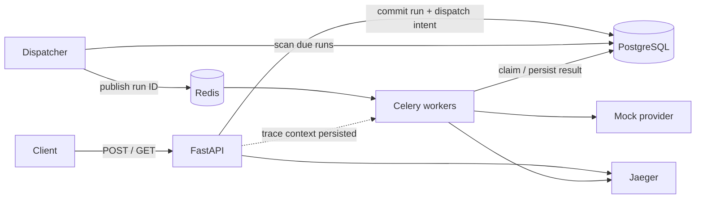

# Siamux

An asynchronous backend for model-generation jobs. FastAPI accepts a request and returns a run ID; Celery workers execute it later, while PostgreSQL persists state, results, and retry schedules. The first provider is a deterministic mock, so the system needs no paid API key.

## Start the stack

Requires Docker Engine with Compose v2 (or Docker Desktop).

```sh
docker compose up --build -d
```

Compose runs PostgreSQL, Redis, a one-shot Alembic migration, the API, a dispatcher, two worker processes, and Jaeger. API readiness is available at <http://localhost:8000/health/ready>. Explore the generated API documentation at <http://localhost:8000/docs> and traces at <http://localhost:16686>.

```sh
curl -i http://localhost:8000/v1/runs \
  -H 'Content-Type: application/json' \
  -H 'Idempotency-Key: my-first-run' \
  -d '{"provider":"mock","input":"Explain asynchronous processing"}'
```

The response is `202 Accepted`, with `id`, `status`, and `status_url`. Poll the returned URL:

```sh
curl http://localhost:8000/v1/runs/REPLACE_WITH_RUN_ID
```

A completed result includes `"status":"SUCCEEDED"` and `"output":{"text":"Mock response: Explain asynchronous processing","model":"mock-basic"}`. Repeating the original POST returns the same run and its current state. Reusing its key with different input returns `409`.

```sh
docker compose logs -f api dispatcher worker
docker compose down
```

Volumes survive `down`. Adding `--volumes` permanently deletes this stack's stored data.

## Architecture



The database run row also serves as durable dispatch intent. The API does not need Redis to accept a request. A separate dispatcher reserves and publishes due runs, then republishes unfinished runs periodically. If Redis is unavailable or loses a message, accepted work remains recoverable in PostgreSQL.

Workers use an atomic conditional update to claim eligible work. A lease prevents competing deliveries from starting the same active attempt. Each attempt gets a fresh token; completion updates must match that token. A worker with an expired lease cannot overwrite a newer attempt's result. Expired leases consume the bounded attempt budget.

This is **at-least-once execution**, with one winning persisted result. If a provider succeeds and a worker crashes before saving the result, the call can happen again. Real providers would need their own idempotency support to avoid duplicate external side effects. There is no exactly-once claim.

## API contract

| Operation | Behavior |
|---|---|
| `POST /v1/runs` | `202`, durably creates a `PENDING` run or returns the existing run |
| `GET /v1/runs/{uuid}` | `200`, current state, timestamps, attempt count, output/error and timings |
| `GET /health/live` | API process is responsive |
| `GET /health/ready` | Database and runs table are accessible; does not claim worker readiness |

Every POST requires a nonblank `Idempotency-Key` of at most 100 characters. Keys are global and retained for the lifetime of the run. Required fields are `provider` (`mock`) and `input` (1–10,000 characters after trimming leading/trailing whitespace; internal whitespace is preserved). `model` defaults to `mock-basic`. Unknown fields are rejected. Defaults and trimmed input are normalized before hashing, so equivalent requests replay consistently. PostgreSQL's unique constraint resolves concurrent key collisions.

Errors share `{"error":{"code":"...","message":"..."}}`; validation errors also include a `fields` list. Invalid fields or UUIDs return `422`, unsupported provider/model returns `400`, unknown runs return `404`, different payloads sharing a key return `409`, and database errors return `503`. Invalid requests create no run. After acceptance, a provider failure is represented in the run returned by GET, whose HTTP status remains `200`.

```text
PENDING -> RUNNING -> SUCCEEDED
              |----> FAILED
              |----> PENDING (retry delay persisted)
```

`error` contains the latest attempt's failure while waiting to retry and is cleared on success. `started_at` records the first attempt; `completed_at` is populated only for terminal states. UTC timestamps are returned with `Z`. `queue_latency_ms` measures acceptance to first claim; `provider_duration_ms` measures the latest attempt. Queued time includes dispatcher polling delay.

## Failure experiments

Use a fresh key for each experiment. Add `mock` options to the request body:

```json
{
  "provider": "mock",
  "input": "retry example",
  "mock": {"delay_seconds": 0.1, "fail_first_attempts": 2}
}
```

- `fail_first_attempts: 2`: succeeds on the third attempt.
- `permanent_failure: true`: fails once without retrying.
- `delay_seconds: 6`: exceeds the default five-second deadline and fails after three attempts.

Defaults are three total attempts, retry delays of one then two seconds, a 30-second execution lease, one-second dispatcher polling, and ten-second message redispatch. Settings are validated and use the `SIAMUX_` prefix; see `.env.example`. The mock is asynchronous and its work is cancelled by the deadline. Any future provider adapter must also use cancellable I/O and explicit network deadlines.

To observe recovery with the running stack:

1. Stop the worker with `docker compose stop worker` and submit jobs. They remain `PENDING`.
2. Restart it with `docker compose start worker`; jobs should complete.
3. Stop Redis with `docker compose stop redis` and submit a fresh job. POST still accepts it durably.
4. Run `docker compose start redis`; the dispatcher resumes delivery after the redispatch window.
5. For a crash test, submit a job with `delay_seconds: 4`, wait for `RUNNING`, and run `docker compose kill -s SIGKILL worker`. Restart the worker; after its lease expires the dispatcher permits recovery. The attempt count increases.

Automate the Redis outage and worker-crash checks with `python scripts/recovery.py`.
This temporarily disrupts this project’s local Compose services and restores them afterward.
Run it when no other local jobs need uninterrupted execution.

## Development and verification

Use Python 3.11+ (Docker uses 3.12):

```sh
python3 -m venv .venv
. .venv/bin/activate
pip install -r requirements.lock
pip install --no-deps -e .
pytest -q
ruff check .
ruff format --check .
```

The lock file pins the resolved runtime and development packages. Unit/service tests use temporary SQLite databases and invoke the real worker logic directly; they do not prove Redis delivery or PostgreSQL concurrency behavior. To run the same tests against a **dedicated disposable PostgreSQL database**, set `SIAMUX_TEST_DATABASE_URL`. The fixture deletes all rows in that test database's `runs` table.

With the Compose stack running:

```sh
python scripts/smoke.py
python scripts/benchmark.py --jobs 100 --concurrency 10 > benchmark-results.json
python scripts/benchmark.py --jobs 100 --concurrency 10 --fail-first 1
```

The smoke test submits real HTTP jobs and verifies success, retries, failure, timeout, replay, and conflict through the actual broker and worker. CI runs the tests against PostgreSQL, checks migrations and formatting, and runs the Compose smoke test. A workflow file is not evidence that CI has run; check your repository's Actions results.

The benchmark is a closed-loop workload: at most `concurrency` jobs are in flight, including polling. It reports measured acceptance p50/p95, completion p95, queue p95, successful jobs/sec, attempts and failures. Completion timing includes up to 100 ms of polling delay. Compare worker counts using `docker compose up -d --scale worker=2` (each replica has two processes). Record machine specs, worker count, workload and configuration with any résumé metric. No throughput numbers are claimed in this repository.

For local processes with Docker providing only infrastructure:

```sh
docker compose up -d postgres redis
cp .env.example .env
alembic upgrade head
uvicorn siamux.api:app --reload
# In separate terminals, using the same virtual environment:
python -m siamux.dispatcher
celery -A siamux.worker:celery_app worker --loglevel=INFO --concurrency=2
```

## Observability and scope

Siamux emits JSON application events with run ID, attempt, state, duration and trace ID; prompt text, output and idempotency keys are excluded. Framework startup logs may use their native format. API spans persist W3C trace context with each run; worker attempt and provider spans continue that trace even after retries. Compose exports traces to Jaeger. Without an OTLP endpoint, trace IDs are still generated but spans are not exported. Jaeger uses ephemeral storage here.

This MVP has no authentication, multitenancy, real AI providers, cancellation, rate limits, metrics dashboard, or cloud deployment. Compose binds exposed services to localhost and uses local-development database credentials. Pending work can grow without a queue limit. Dispatch scanning is intentionally simple and can produce duplicate messages; scaling it is a future measurement-driven improvement.

See [verified checks](docs/verification.md) for the recorded implementation checks.
