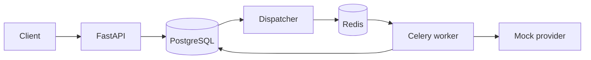

# Siamux

Siamux is an asynchronous job-processing service built with FastAPI, PostgreSQL, Redis, and Celery. Clients submit generation requests, receive a run ID, and poll for results. PostgreSQL stores job state and retry schedules; Redis transports work to the workers.

The current implementation uses a configurable mock provider for testing timeouts, retries, and recovery. It does not require an external API key.

## Quick start

Requires Docker with Compose.

```sh
git clone https://github.com/VihanP29/siamux.git
cd siamux
docker compose up --build -d --wait
```

This starts the API, PostgreSQL, Redis, dispatcher, Celery worker, and Jaeger. Database migrations run automatically before the application starts.

- [API documentation](http://localhost:8000/docs)
- [Traces](http://localhost:16686)

Submit a run:

```sh
curl -i http://localhost:8000/v1/runs \
  -H 'Content-Type: application/json' \
  -H 'Idempotency-Key: example-001' \
  -d '{"provider":"mock","input":"Summarize this request"}'
```

The API returns `202 Accepted` with a run ID and `status_url`. Use that URL to retrieve the state and result:

```sh
curl 'http://localhost:8000/v1/runs/<run_id>'
```

To inspect logs or stop the services:

```sh
docker compose logs -f api dispatcher worker
docker compose down
```

Database and Redis volumes are retained when the stack stops.

## Architecture



The API commits a run before returning its ID. A dispatcher reads due runs from PostgreSQL and publishes their IDs to Redis. Accepted jobs remain in the database during a broker outage and are dispatched when Redis becomes available again.

Workers claim runs with an atomic database update and an execution lease. Each attempt receives a token that must match when saving its result, preventing an older attempt from overwriting a newer one. Expired leases allow work to be retried within the attempt limit.

Execution is **at least once**. A crash after a provider call but before the result is committed can cause that call to be repeated. Submission idempotency prevents duplicate run records; it does not guarantee exactly-once provider execution.

## API

| Endpoint | Description |
| --- | --- |
| `POST /v1/runs` | Accept a request or return an existing run for the same idempotency key |
| `GET /v1/runs/{run_id}` | Retrieve state, result, error, timestamps, and attempt count |
| `GET /health/live` | Check API availability |
| `GET /health/ready` | Check database connectivity and schema availability |

Requests require an `Idempotency-Key` header containing 1–100 characters and a nonblank value. Repeating a key with the same normalized request returns the original run; a different request returns `409 Conflict`. Keys are global and retained with the run.

The request body requires `provider: "mock"` and `input` containing 1–10,000 characters after trimming surrounding whitespace. `model` defaults to `mock-basic`. Unknown fields are rejected. See the generated API documentation for the full schema.

Runs move from `PENDING` to `RUNNING`, then to `SUCCEEDED` or `FAILED`. Retryable failures return to `PENDING` until the next attempt is due. A failed run is returned by GET with HTTP `200` and a structured `error`; invalid submissions are rejected before a run is created.

## Configuration

Settings use the `SIAMUX_` prefix. See [.env.example](.env.example) for local process settings. Container settings are defined in [compose.yaml](compose.yaml).

| Setting | Default |
| --- | --- |
| `SIAMUX_PROVIDER_TIMEOUT` | 5 seconds |
| `SIAMUX_MAX_ATTEMPTS` | 3 total attempts |
| `SIAMUX_RETRY_BASE_SECONDS` | 1 second, doubled after each retryable failure |
| `SIAMUX_LEASE_SECONDS` | 30 seconds |
| `SIAMUX_DISPATCH_INTERVAL` | 1 second |
| `SIAMUX_REDISPATCH_SECONDS` | 10 seconds |

The mock provider accepts optional fault-injection settings:

```json
{
  "provider": "mock",
  "input": "retry test",
  "mock": {
    "delay_seconds": 0.1,
    "fail_first_attempts": 2
  }
}
```

With the default configuration, this request succeeds on its third attempt. Set `permanent_failure` to `true` to fail without retrying, or `delay_seconds` to `6` to exercise provider timeouts.

## Development

Requires Python 3.11 or later. The Docker image uses Python 3.12.

```sh
python3 -m venv .venv
. .venv/bin/activate
pip install -r requirements.lock
pip install --no-deps -e .

pytest -q
ruff check .
ruff format --check .
```

Tests use temporary SQLite databases by default. Set `SIAMUX_TEST_DATABASE_URL` to run them against PostgreSQL. Use a disposable test database: the fixtures clear its `runs` table.

With the Compose stack running:

```sh
python scripts/smoke.py
python scripts/recovery.py
python scripts/benchmark.py --jobs 100 --concurrency 10
```

The smoke test covers successful execution, retries, timeouts, permanent failures, and idempotency. The recovery test temporarily stops Redis and kills a worker, then restores both services and checks job completion.

The benchmark reports acceptance latency, completion latency, queue latency, and successful jobs per second. It limits concurrent in-flight jobs and includes polling overhead; it is not a measurement of maximum API throughput.

[CI](.github/workflows/ci.yml) checks formatting, PostgreSQL tests, migrations, and the Compose smoke and recovery tests.

## Observability

Application logs include run IDs, attempt counts, state transitions, durations, and trace IDs. Prompt text, output, and idempotency keys are excluded. OpenTelemetry context is persisted with each run so API, worker, and provider spans share a trace across retries. Compose exports traces to Jaeger.

Run responses include `queue_latency_ms` for the time between acceptance and the first attempt, and `provider_duration_ms` for the latest attempt.

## Current scope

This is a local development setup. Services bind to localhost and use development credentials; Jaeger storage is ephemeral. Authentication, tenant isolation, real provider integrations, cancellation, and admission limits are not implemented.
